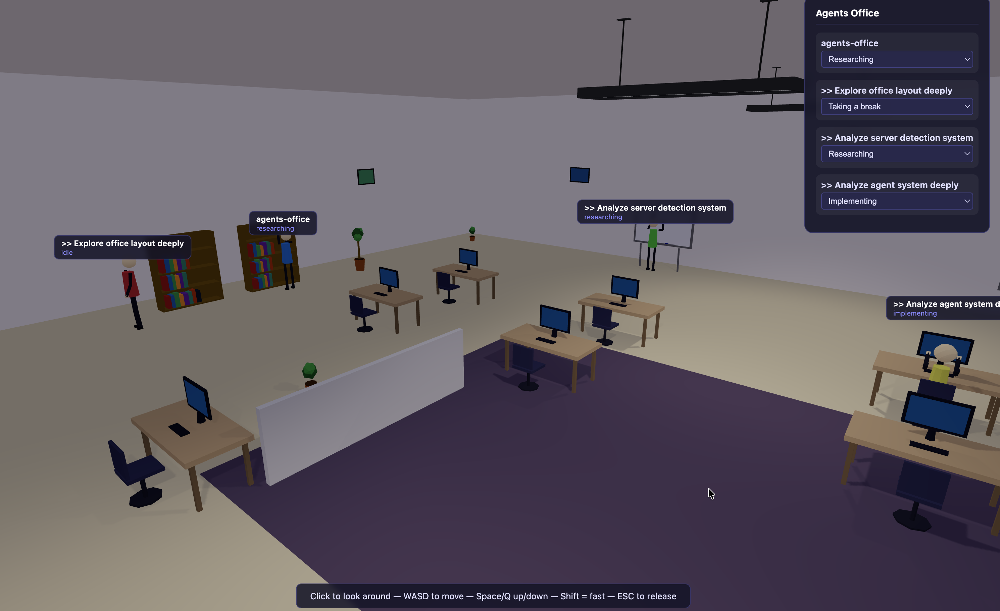

# Agents Office

A 3D office visualization that shows your running [Claude Code](https://claude.ai/code) agents as animated stick figures. Each agent's real-time activity is detected from session data and mapped to a physical station in the office — coding at a desk, reading at the bookshelf, writing on the whiteboard, and more.



## Quick start

```bash
npx agents-office          # opens http://127.0.0.1:5173
npx agents-office 5180     # another port
```

From source, run the checks first:

```bash
pnpm install --frozen-lockfile --ignore-scripts
pnpm audit --audit-level=low
pnpm test
pnpm typecheck
pnpm build
pnpm dev
```

## Local security boundary

The dashboard is for local use. Both launch paths bind to `127.0.0.1`; attempts to
use a network-wide host such as `--host 0.0.0.0` are rejected. The agent API accepts
only loopback clients, and browser requests must come from the dashboard's own
origin. Do not expose it through a public tunnel, reverse proxy, or port forward.

The API returns only display names, activities, and opaque IDs that change when
the server restarts. It does not return working-directory paths, PIDs, start times,
or raw session IDs. Display names can still contain project or task context, and
other software running on your computer can access the local dashboard without a
login. Run it only on a trusted machine.

## How It Works

The app reads the Claude Code session files in `~/.claude/sessions/` on your machine. For each live session it reads that session's own transcript and the status that Claude Code writes in the session file. From those it computes one value, the **activity**. Everything you see derives from it: where the agent stands, how it moves, and what its label says.

```
~/.claude/sessions/*.json   one file per running session (pid, sessionId, cwd, status)
        │  server: keep valid sessions whose process is alive
        ▼
  activity = session status + newest tool call in the session's own transcript
        │  + subagents of that session (active in the last 30 s, or in a long tool call)
        ▼  GET /api/agents  →  [{ id, name, activity, parentId? }]
  browser, every 3 s: add, update or remove figures
        ▼
  activity → station type → free seat of that type (or an overflow spot) → walk there → pose
```

### Status: how the activity is computed

The session status comes first. The transcript tells what kind of work the agent does.

| Session status | Activity |
|---|---|
| waiting (for a permission or an answer) | Waiting for you (meeting table) |
| idle | Taking a break (coffee machine) |
| busy, and the newest message is text | Planning (whiteboard): the agent is thinking |
| busy with a tool call, or no status in the file | From the newest tool call, below |

| Newest tool call | Activity |
|---|---|
| Read, Grep, Glob, WebSearch, WebFetch, Agent, Skill, ToolSearch | Researching (bookshelf) |
| MCP tool whose name holds get, list, search, read, fetch, query, find, view, lookup or describe | Researching (bookshelf) |
| Edit or Write on `.md`, `.rst`, `.txt`, README or `docs/` | Writing docs (review desk) |
| Edit, Write, NotebookEdit on other files, other MCP tools | Implementing (desk) |
| EnterPlanMode, ExitPlanMode, TaskCreate, TaskUpdate | Planning (whiteboard) |
| AskUserQuestion | Waiting for you (meeting table) |
| Bash, see below | depends on the programs it runs |
| Text only, no tool call | Taking a break (coffee machine) |

Shell commands are split into simple commands (`&&`, `;`, `|`). The first rule that matches any of them wins:

| Programs | Activity |
|---|---|
| Test runners: `pnpm test`, `npm test`, `jest`, `vitest`, `pytest`, `cargo test`, `go test`, `node --test` | Testing (test station) |
| `git commit`, `git push`, `docker push`, `kubectl apply`, `terraform apply`, `npm run deploy`, `deploy.sh` | Deploying (celebrating) |
| `git diff`, `git log`, `git show`, `git blame`, `gh pr view` | Reviewing (review desk) |
| `curl`, `wget`, `lsof`, `gdb`, `lldb`, `strace`, `node --inspect` | Debugging (desk) |
| Only read-only programs: `ls`, `cat`, `rg`, `grep`, `find`, `git status`... | Researching (bookshelf) |
| Anything else | Implementing (desk) |

### Location: stations

| Station | Where | Seats | Activities |
|---|---|---|---|
| Coding desks | Two rows in the center | 8 | Implementing, Debugging, Deploying |
| Review desks | Front row | 3 | Reviewing, Writing docs |
| Whiteboards | Back wall | 2 | Planning |
| Bookshelves | Left wall | 2 | Researching |
| Test stations | Right side | 2 | Testing |
| Coffee machine | Front left | 2 | Taking a break |
| Meeting table | Front right | 3 | Waiting for you |

- A new agent appears directly at its seat. When its activity changes, it walks to a seat of the new type.
- If the new activity uses the same station type (implementing to debugging), the agent stays where it is and only changes its pose.
- One agent per seat. When no seat of the right type is free, the agent stands on an overflow spot on open floor. It never takes a seat of another type, so the place always matches the activity.

### Position: poses

| Activity | Pose |
|---|---|
| Implementing | Seated, typing |
| Debugging | Seated, scratching the head |
| Reviewing | Seated, hand on chin |
| Writing docs | Seated, writing on paper |
| Planning | Standing, writing on the whiteboard |
| Researching | Standing, reaching for a book |
| Testing | Standing, arms crossed |
| Waiting for you | Standing, gesturing |
| Taking a break | Standing, holding a coffee cup |
| Deploying | Jumping, both hands up |

### Identity: name, color, label

- **Name:** the folder name of the session. Subagents show `>>` followed by their task description.
- **Color:** one of 8 shirt colors, from a hash of the agent ID, so an agent keeps its color across reloads.
- **Label:** the name and the activity text float over each figure. The side panel lists the same agents. Its menu lets you preview another activity until the next update.

## Plugins

Optional plugins add data from other tools. None run by default.

```bash
AGENTS_OFFICE_PLUGINS=name1,name2 pnpm dev
npx agents-office --plugin name1 --plugin name2
```

A plugin is a folder `plugins/<name>/` with an `index.ts` (server: sources, enrichers, rooms and boards) and an optional `client.ts` (browser rendering). The server copies only whitelisted, cleaned fields to the browser.

`pnpm dev:fork` starts the dev server with the plugins of this fork (now `herdr`).

### herdr plugin

For sessions that run in [herdr](https://herdr.dev) panes. Each Claude session shows the name of its herdr tab. The session and its subagents get a group: the herdr workspace. Subagents keep their own `>>` names.

What it reads:

- `ps eww -o pid=,command= -p <pids>` once for the session processes it has not seen yet. From that output it keeps only `HERDR_PANE_ID`, `HERDR_TAB_ID` and `HERDR_WORKSPACE_ID`. It keeps or logs no other variable.
- `herdr tab list` and `herdr workspace list`, at most once every 10 s.

All commands are read-only. They run through `execFile` with fixed arguments and a 1.5 s timeout, never through a shell. If herdr is not installed, a session is not in herdr, or a command fails, the session keeps its normal name and has no group. Raw herdr IDs stay on the server: the API sends only a hashed group ID and the cleaned labels.

Enable it:

```bash
AGENTS_OFFICE_PLUGINS=herdr pnpm dev   # or: pnpm dev:fork
```

## Controls

- **Click** to engage camera
- **W/A/S/D** or **Arrow keys** to move
- **Space/Q** to go up/down
- **Shift** to move faster
- **Mouse** to look around
- **Esc** to release camera
- **L** to switch the layout, when more than one is installed (also `?layout=<id>` in the URL)

## Architecture

```
~/.claude/sessions/*.json → Vite middleware → GET /api/agents → Browser polls every 3s → 3D scene updates
```

- **Server**: Vite plugin reads Claude session files, validates PIDs, combines the session status with the newest tool call of the session's own transcript, and detects that session's active subagents
- **Client**: Three.js scene with toon-shaded stick figures, station-based layout, walking animations, and per-activity poses

## Requirements

- Node.js 22.12+
- One or more running Claude Code sessions to visualize
